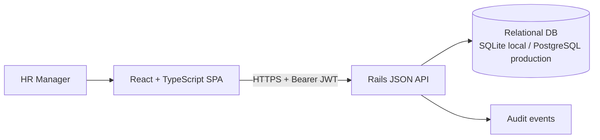

# Architecture

## Topology

The UI is a thin client. Business rules, filtering, pagination, aggregation and authorization live in Rails so they remain consistent across clients.

## Data model

- `users`: HR identity, password digest and role.
- `employees`: stable employee code, contact/work identity, country, department, title, employment status and hire date.
- `salary_records`: employee, annual gross amount, ISO currency, effective start and optional end date. Historical rows are retained.
- `audit_events`: actor, action, target type/id and structured metadata.

Each employee can have many salary records. A salary interval is inclusive (`effective_from` through `effective_to`); null end date means open-ended. The salary creation service locks the employee, closes a superseded open interval, and rejects remaining overlaps within a transaction.

## API boundaries

`/api/v1` JSON endpoints. JWT is issued at sign-in and expires after 8 hours. Only the HR Manager role is admitted by the API guard. Pagination is server-side and capped at 100. Filter/sort inputs are allow-listed; SQL values are parameterized. API responses expose only fields needed by the UI.

## Performance approach

- Index employee code, email, country, department, status, salary currency/effective dates and audit target.
- Search is bounded and paginated; response payloads do not include full salary histories in list endpoints.
- Dashboard aggregates execute in SQL and group by currency.
- Seed data is deterministic and generated in batches to avoid 10,000 individual insert round trips where practical.

## Production posture

Use PostgreSQL in production, HTTPS, strong `SECRET_KEY_BASE`, a rotated seed/admin password, strict CORS allow-list, managed backups, centralized logs and monitoring. Add SSO/MFA, fine-grained permissions and privacy retention policy before real payroll data is loaded.

## Runtime performance and background work

- Dashboard reads use `DashboardSnapshot`, which performs grouped SQL aggregates and caches the result for two minutes. The cache is private to the authenticated application and is explicitly expired after successful employee or salary mutations.
- `DashboardCacheRefreshJob` refreshes the snapshot asynchronously on the low-priority Sidekiq queue. Redis is shared by the web and worker processes in production; development/test use local memory caches for simple setup.
- Employee index responses preload the scoped `current_salary_record` association, not the entire salary history. Employee detail responses preload both the history and current record because the UI explicitly requests history.
- `Rack::Attack` throttles login attempts per IP. Production Redis should be used as the shared throttle/cache store when running multiple web instances.
- The dashboard uses SQL `GROUP BY` and `SUM`/`COUNT`; it never adds unlike currencies together or converts using an unstated exchange rate.

## Operational topology

The production topology is a Rails/Puma web process, PostgreSQL, Redis, and one or more Sidekiq worker processes. Run the worker with `bundle exec sidekiq -C config/sidekiq.yml`. Configure `REDIS_URL`, `DATABASE_URL`, `SECRET_KEY_BASE`, and a strong `SEED_ADMIN_PASSWORD` outside source control. The Sidekiq Web UI is mounted only in development; if enabled in a production environment later, it must be protected by authenticated admin authorization.
